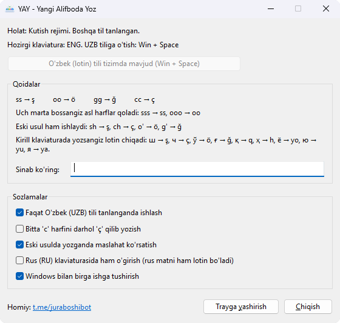

# YAY — Yangi Alifboda Yoz



**YAY** o'zbek lotin alifbosining yangi harflarini (ş, ç, ö, ğ) oddiy klaviaturada yozish uchun kichik Windows dasturi. Kirill klaviaturaga o'rganib qolganlar uchun esa kirillda yozganini yangi lotin alifbosiga o'giradi. U tizim patnisida ishlaydi va faqat O'zbek (lotin) yoki O'zbek (kirill) klaviaturasi tanlanganda ishlaydi (Win + Space). Ingliz klaviaturasiga tegmaydi. Rus klaviaturasiga faqat sozlamada yoqsangiz tegadi.

**YAY** is a small Windows program for typing the new Uzbek Latin letters (ş, ç, ö, ğ) on a regular keyboard. For people who are used to a Cyrillic keyboard, it also converts what they type in Cyrillic into the new Uzbek Latin alphabet. It runs in the tray and only acts while the Uzbek (Latin) or Uzbek (Cyrillic) keyboard layout is selected (Win + Space). The English layout is left alone, and the Russian layout is only used if you turn it on in the settings.

Homiy / Sponsor: [t.me/juraboshibot](https://t.me/juraboshibot)

## Qoidalar / Typing rules

| Harf / Letter | Tez usul / Fast | Oddiy ikki harf / Plain double | Eski usul / Legacy |
| :---: | :---: | :---: | :---: |
| ş Ş | `ss` `SS` | `sss` → `ss` | `sh` `SH` |
| ç Ç | `cc` `CC` | `ccc` → `cc` | `ch` `CH` |
| ö Ö | `oo` `OO` | `ooo` → `oo` | `o'` `O'` |
| ğ Ğ | `gg` `GG` | `ggg` → `gg` | `g'` `G'` |

- Bir xil harfni ikki marta tez bossangiz, ular bitta yangi harfga almashadi: `ss` → ş. Oddiy ikki harf kerak bo'lsa (*Rossiya*, *issiq*), uchinchi marta bosing: `sss` → `ss`. Keyingi bosishlar oddiy harf bo'lib qoladi: `ssss` → `sss`.
- "Tez" taxminan 0,35 soniya. Eski usullar (`sh`, `ch`, `o'`, `g'`) tezlikka bog'liq emas.
- Enter, Tab va Escape tugmalariga hech qachon tegilmaydi.
- ş dan keyin s keladigan so'zlarda (*işsiz*, *tuşsa*) `sh` + `s` yozing yoki ikkinchi `s` dan keyin biroz to'xtang.
- Dastur oynasida "Bitta 'c' harfini darhol 'ç' qilib yozish" sozlamasi bor.

Tap the same letter twice quickly to get the new letter: `ss` → ş. If you need the plain double letter (*Rossiya*, *issiq*), tap a third time: `sss` → `ss`. Further taps stay plain: `ssss` → `sss`. "Quickly" means about 0.35 seconds. The legacy forms (`sh`, `ch`, `o'`, `g'`) have no time limit. Enter, Tab and Escape are never touched. For words with ş followed by s (*işsiz*, *tuşsa*), type `sh` + `s`, or pause briefly before the last `s`.

### Kirilldan lotinga / Cyrillic to Latin

Kirill klaviaturaga o'rganganlar uchun: O'zbek (kirill) klaviaturasi tanlansa, kirillda yozganingiz yangi lotin alifbosiga o'giriladi. Tugmalar odatdagidek, faqat ekranda lotin chiqadi. Rus (RU) klaviaturasida bu faqat dastur oynasida "Rus (RU) klaviaturasida ham o'girish" belgilansa ishlaydi, chunki RU da rus tilida ham yozasiz. Belgilangan bo'lsa, rus matni ham lotinga o'giriladi: rus tilida yozish uchun belgini olib tashlang yoki tray belgisini bosib YAY ni to'xtating.

| Kirill | Lotin | Misol |
| :---: | :---: | :--- |
| ш Ш | ş Ş | шаҳар → şahar |
| ч Ч | ç Ç | чой → çoy |
| ў Ў | ö Ö | Ўзбекистон → Özbekiston |
| ғ Ғ | ğ Ğ | ғалаба → ğalaba |
| қ ҳ х | q h x | қалам → qalam, ҳаво → havo, яхши → yaxşi |
| ё ю я | yo yu ya | ёмон → yomon, юрак → yurak |
| е | ye so'z boshida va unlidan keyin, boshqa joyda e | Европа → Yevropa, беш → beş |
| э | e | эшик → eşik |
| ц щ ы | ts şç i | цирк → tsirk |
| ъ | ʼ | маъно → maʼno |
| ь | yozilmaydi | сентябрь → sentyabr |

Shift bilan bosilgan ё, ю, я katta harf bilan boshlanadi (*Юлдуз* → *Yulduz*). Caps Lock yoqilgan bo'lsa to'liq katta harf chiqadi (*ЮЛДУЗ* → *YULDUZ*). ў, қ, ғ, ҳ tugmalari faqat O'zbek (kirill) klaviaturasida bor.

If you are used to a Cyrillic keyboard: while the Uzbek (Cyrillic) layout is selected, what you type in Cyrillic comes out in the new Uzbek Latin alphabet. The keys are the same, only the screen shows Latin. On the Russian (RU) layout this works only if you tick "Rus (RU) klaviaturasida ham o'girish" in the program window, because you may also use RU to write real Russian. With it ticked, Russian text is converted too: to write Russian, untick it or click the tray icon to pause YAY. The table above shows the mapping. *е* becomes *ye* at the start of a word and after a vowel, and *e* elsewhere. Shift gives *Yu*, Caps Lock gives *YU*. The keys for ў, қ, ғ, ҳ exist only on the Uzbek (Cyrillic) layout.

## O'rnatish / Install

[Releases](https://github.com/nodiranor/yangi_alifboda_yoz/releases) sahifasidan `YAY_Setup.exe` (o'rnatuvchi) yoki `YAY.exe` (o'rnatmasdan ishlaydi) ni yuklab oling. Windows 7 SP1 va undan yangisi, 32 yoki 64 bit. `YAY.exe /tray` oynasiz, faqat tizim patnisida ishga tushadi.

Download `YAY_Setup.exe` (installer) or the portable `YAY.exe` from the Releases page. Windows 7 SP1 or newer, 32 or 64 bit. `YAY.exe /tray` starts in the tray without a window.

O'zbek (lotin) klaviaturasi Windows 8 va undan yangisida o'rnatuvchi yoki dastur oynasidagi tugma orqali qo'shiladi. Windows 7 da tugma ro'yxatga yozuv qo'shadi, undan keyin tizimdan chiqib qayta kirish kerak.

On Windows 8 and later the Uzbek (Latin) layout is added by the installer or by the button in the program window. On Windows 7 the button writes the registry entries, and you need to sign out and back in.

## Yig'ish / Building

Visual Studio 2022 ("Desktop development with C++") kerak. O'rnatuvchi uchun Inno Setup 6 ham kerak.

You need Visual Studio 2022 with the "Desktop development with C++" workload, and Inno Setup 6 for the installer.

```bat
build.cmd
```

Skript dvigatel testlarini ishga tushiradi, so'ng `YAY.exe` va (Inno Setup topilsa) `Output\YAY_Setup.exe` ni yig'adi. The script runs the engine tests, then builds `YAY.exe` and, if Inno Setup is found, `Output\YAY_Setup.exe`.

```bat
tests\e2e.cmd
```

Bu real klaviatura bosishlarini dastur oynasidagi sinov maydoniga yuboradi va natijani tekshiradi. U ishlayotgan YAY ni to'xtatadi. This types real key presses into the program's test box and checks the result. It stops any running YAY.

Ikonkalarni `Icon.png` dan qayta yaratish (Pillow kerak) / regenerate the icons from `Icon.png` (needs Pillow):

```bat
python tools/make_icons.py Icon.png res/app.ico res/app_paused.ico
```

## Eslatmalar / Notes

- Klaviatura `WH_KEYBOARD_LL` hook orqali kuzatiladi, almashtirish `SendInput` bilan yuboriladi. Dastur tarmoqqa ulanmaydi va yozilganlarni saqlamaydi. / Keys are watched with a low-level keyboard hook and replacements are sent with `SendInput`. The program makes no network connections and does not store what you type.
- `YAY.exe` C runtime kutubxonasisiz yig'iladi (taxminan 57 KB), shuning uchun kodda `printf` yoki STL o'rniga Win32 funksiyalari ishlatiladi. / `YAY.exe` is linked without the C runtime (about 57 KB), so the code uses Win32 functions instead of `printf` or the STL.
- Cheklov: avtomatik to'ldirish bor maydonlarda (masalan, Chrome manzil satri) YAY yuboradigan Backspace harf o'rniga taklif qilingan matnni o'chirishi mumkin. / Known limitation: in fields with inline autocomplete (for example the Chrome address bar), the Backspace that YAY sends can delete the suggested text instead of the typed letter.

## Litsenziya / License

[MIT](LICENSE)
